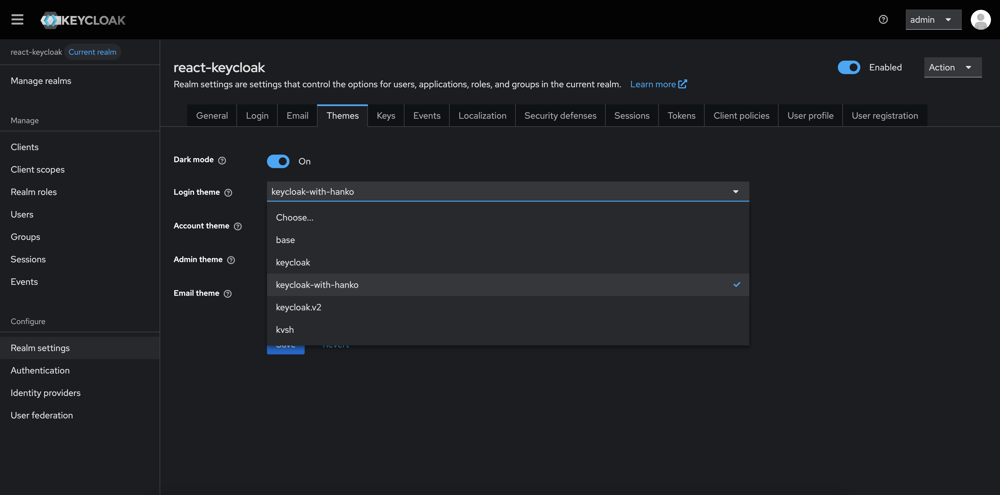
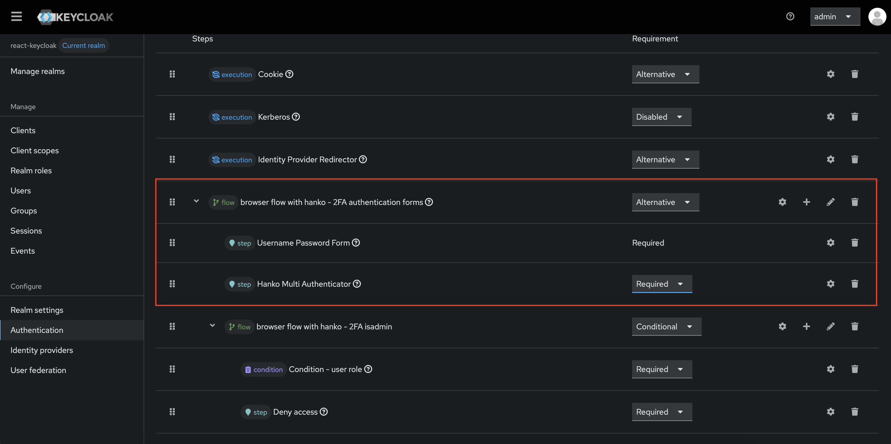
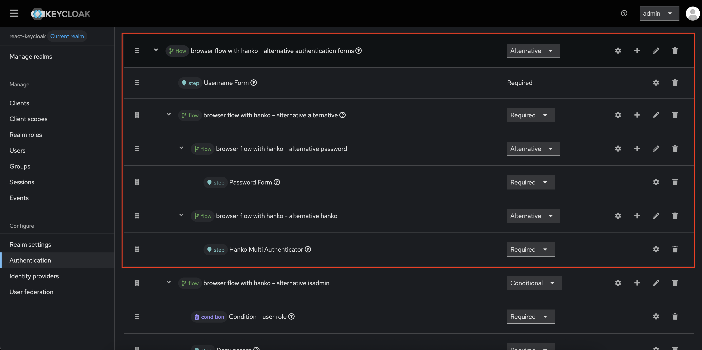

# Hanko Plugin for Keycloak

This is an extension to Keycloak which integrates passwordless authentication via Hanko.

For more information about Keycloak, please visit the [Keycloak homepage](https://www.keycloak.org/).

> [!IMPORTANT]
> The plugin requires access to the Hanko API. Contact us at info@hanko.io for more info.

## Features

- Log in with either password, Hanko Authenticator (FIDO UAF) or WebAuthn (FIDO2).
- Enrollment of users via provided Keycloak admin API extension endpoints - "pre"-register FIDO2 roaming authenticators (security keys)
or initiate device binding using the Hanko Authenticator.

## Table of contents
- [Compatibility](#compatibility)
- [Installation](#installation)
- [Building](#building)
- [Running with Docker](#running-with-docker)
- Configuration
    - [Configure a client](#configure-a-client)
    - [Configure authentication flows](#configure-authentication-flows)
      - [Prerequisites](#prerequisites)
      - [Hanko 2FA flow](#hanko-2fa-flow)
      - [Hanko alternative flow](#hanko-alternative-flow)
- Using the Plugin API
    - [Preliminary notes](#preliminary-notes)
    - [OpenAPI Spec](#openapi-spec)
    - [Register devices](#register-devices)
      - [Register a WebAuthn device](#register-a-webauthn-device)
      - [Register a UAF device/Authenticator App](#register-a-uaf-deviceauthenticator-app)
      - [Get the status of a UAF device/Authenticator App request](#get-the-status-of-a-uaf-deviceauthenticator-app-request)
      - [Cancel a UAF device/Authenticator App request](#cancel-a-uaf-deviceauthenticator-app-request)
    - [Device management](#device-management)
        - [Retrieve devices](#retrieve-devices)
        - [Deregister devices](#deregister-devices)
          - [Deregister a WebAuthn device](#deregister-a-webauthn-device)
          - [Deregister a UAF device/Authenticator App device](#deregister-a-uaf-deviceauthenticator-app)
        - [Rename devices](#rename-devices)
          - [Rename a WebAuthn device](#rename-a-webauthn-device)
          - [Rename a UAF device/Authenticator App device](#rename-a-uaf-deviceauthenticator-app-device)


## Compatibility

The latest version of this plugin (3.0.7) has been tested with Keycloak 26.5.2

You can also build the plugin yourself, see section [Building](#building) for more details.

## Installation

1. Download the latest version artifacts (`hanko-keycloak-plugin.jar`) from the 
[GitHub releases page](https://github.com/teamhanko/hanko-keycloak-plugin/releases) or build them yourself 
(see section [Building](#building)).
2. Copy `hanko-keycloak-plugin.jar` to `<KEYCLOAK_ROOT>/providers/hanko-keycloak-plugin.jar`

## Building

Ensure you have JDK 21 (or newer), Maven 3.8.9 (or newer) and Git installed:

```
java -version
mvn -version
git --version
```

Clone this repository:

```
git clone https://github.com/teamhanko/hanko-keycloak-plugin.git
cd hanko-keycloak-plugin
```

Build the plugin `jar` by running the following in the project root directory:

```
mvn clean package
```

You can find the `hanko-plugin-keycloak-<version>-kc<keycloak_version>.jar` in the `target` folder 
of the `hanko-plugin-keycloak` directory.

## Running with Docker

Build the `jar` as described in the [Building](#building) section.

In the project root run:

```
docker run -it \
  --name <container_name>\
  -p 8088:8080 \
  -v $(pwd)/hanko-plugin-keycloak/target/hanko-plugin-keycloak-<version>-kc<kv_version>.jar:/opt/keycloak/providers/hanko.jar \
  -e KEYCLOAK_ADMIN=admin \
  -e KEYCLOAK_ADMIN_PASSWORD=admin \
  quay.io/keycloak/keycloak:<kv_version> \
  start
```

Alternatively:

The repository contains a Dockerfile that can be used to create an image and run Keycloak with the plugin in a container.
The Dockerfile uses the [keycloak](https://quay.io/repository/keycloak/keycloak) image.

Build the Docker image:

```
docker build -t <TAG> .
```

Run the container and create an initial admin account (to be able to open Keycloak on localhost map port 8080 
locally).

```
docker run -e KEYCLOAK_ADMIN=<USERNAME> -e KEYCLOAK_ADMIN_PASSWORD=<PASSWORD> -p 8080:8080 <TAG>
```

Keycloak uses an embedded H2 database per default. To run the container using a different database configuration see
the section **Database** for the [keycloak](https://quay.io/repository/keycloak/keycloak) image.

## Configure a client

Before you start, you need to create a client in Keycloak. The client will be used to authenticate with Hanko. 
The client ID and client secret will be used to configure Hanko.

1. Log in to your Keycloak administration console.
2. Go to the **Clients** section and click **Create**.
3. Select **OpenID connect** as the **Client Type**, enter a **Client ID** and optionally a **Name** and **Description**.
4. Click **Next**
5. Under **Authentication flow**, select **Standard flow**. If you plan on retrieving access tokens
via Oauth Resource Owner Password Credentials Grant flow, also check **Direct access grants**.
6. Click **Next**
7. As **Home URL** enter the URL where your client application runs, e.g. `http://localhost:3000`.
8. As **Valid Redirect URIs** enter the URL in your application or use globbing, e.g. `http://localhost:3000/*`. 
9. As **Web origins** enter the URL where your client application runs, e.g. `http://localhost:3000`.

## Configure authentication flows

### Prerequisites

The plugin uses the Hanko API to perform authentication. Hanko API endpoints are protected and hence require an 
API Key ID/API Key pair to make authorized requests. In order to obtain an API Key ID/API Key pair, please
contact a Hanko team member. 

> **Warning**
> Do not make the API Key publicly available.

The API Key ID/API Key pair will be used to configure Keycloak authentication flows (see the following sections for
details).

### Hanko 2FA flow

1. Log in to your Keycloak administration console.
2. Go to configuration section **Realm Settings**, open the Themes tab and select `keycloak-with-hanko` as your 
**login-theme**. 
3. Go to configuration section **Authentication**.
4. Click the three dots on the right for the **Browser** authentication flow.
5. Click **Duplicate** in the top right corner of the table.
6. Give the new flow a meaningful name, for example **Browser flow with Hanko - 2FA**.
7. Under the browser **Browser flow with Hanko - 2FA authentication forms** flow, remove any unwanted sub-flows/exections but keep
the **Username Password Form**.
8. In the **Browser flow with Hanko - 2FA authentication forms** row, click the **+** icon and select **Add execution**. Search for
**Hanko Multi Authenticator**, select it and click **Add**. Mark it as **Required**.
9. Open the configuration of the **Hanko Multi Authenticator** flow by clicking the gear icon. Provide 
an alias for the configuration. Set the **Hanko API URL** to `https://api.hanko.app`. Provide your API Key ID and API 
Key secret as **Hanko API KEY ID** and **Hanko API KEY**. Save the configuration.
10. Scroll to the top right of the page and select **Action** -> **Bind flow** and under **Choose binding type** select
**Browser Flow**. Save the configuration.


        
> **Warning**
> Be careful when applying this authentication configuration to a realm, especially the master realm. Using this 
> configuration a user **must** have a device registered in order to properly log in. If you are a (master) realm admin 
> user without registered devices and apply this configuration as your bound browser flow, you can lock yourself out of
> your realm app or the keycloak administration console. You can register devices by configuring Hanko authentication
> as an alternative first, see [Hanko alternative flow](#hanko-alternative-flow)


### Hanko alternative flow

1. Log in to your Keycloak administration console.
2. Go to configuration section **Realm Settings**, open the Themes tab and select `keycloak-with-hanko` as your
   **login-theme**. 
3. Go to configuration section **Authentication**.
4. Click the three dots on the right for the **Browser** authentication flow.
5. Click **Duplicate** in the top right corner of the table.
6. Give the new flow a meaningful name, for example **Browser flow with Hanko - alternative**.
7. Under the browser **Browser flow with Hanko - alternative authentication forms** flow, remove any unwanted sub-flows/exections.
8. In the **Browser flow with Hanko - alternative authentication forms** row, click the **+** icon and select **Add execution**. Search for
   **Username Form**, select it and click **Add**. Mark it as **Required**.
9. In the **Browser flow with Hanko - alternative authentication forms** row, click the **+** icon and select **Add sub-flow**. 
   Give it a name and set the **Flow type** to **generic**. Mark it as **Required**
10. Add another sub-flow to the newly created sub-flow. Mark it as **Alternative**.
11. In the sub-flow created in step 10, click the **+** icon and select **Add execution**. Search for
    **Password Form**, select it and click **Add**. Mark it as **Required**.
12. In the sub-flow created in step 9, click the **+** icon and add another sub-flow. Mark it as **Alternative**.
13. In the sub-flow created in step 12, click the **+** icon and select **Add execution**. Search for
    **Hanko Multi Authenticator**, select it and click **Add**. Mark it as **Required**.
13. Open the configuration of the **Hanko Multi Authenticator** flow by clicking the gear icon. Provide
    an alias for the configuration. Set the **Hanko API URL** to `https://api.hanko.app`. Provide your API Key ID and API
    Key secret as **Hanko API KEY ID** and **Hanko API KEY**. Save the configuration.
14. Scroll to the top right of the page and select **Action** -> **Bind flow** and under **Choose binding type** select
    **Browser Flow**. Save the configuration.



## Using the Plugin API

### OpenAPI Spec

An OpenAPI specification for the endpoints can be found in the `/docs` directory (`spec.yaml`).

### Preliminary notes

> [!IMPORTANT]
> In order to register a device for a user from a specific realm said realm  **must** have a
> **Hanko Multi Authenticator** execution configured in the Authentication configuration of the bound browser flow
> (see [Configure Authentication Flows](#configure-authentication-flows)).

> [!IMPORTANT]
> The session user/bearer of the access token **must** be able to manage users (role: `manage-users`)
> in the realm of the user they want to perform actions for through the API endpoints.

### Authentication with the Admin API

Common ways to retrieve access tokens are via direct access grants for your client or using a service account client.

#### Direct access grant

Select your realm, then go to **Clients** and select your client. Under **Capability config**
check **Direct access grants**.

Then obtain a token by posting user credentials to the Keycloak token endpoint:

```bash
curl -X POST "<keycloak_server_url>/realms/<realm>/protocol/openid-connect/token" \
  -H "Content-Type: application/x-www-form-urlencoded" \
  -d "grant_type=password" \
  -d "client_id=<your_client_id>" \
  -d "username=<username>" \
  -d "password=<password>"
```

If **Client authentication** is enabled for your client (confidential client), also include `-d "client_secret=<your_client_secret>"` in the request.

#### Service account client

A service account client is a confidential client that obtains tokens via the client credentials grant without requiring user interaction — suitable for backend or automated workflows.

First, create a dedicated client: select your realm, go to **Clients** → **Create client**. Set **Client type** to `OpenID Connect` and provide a **Client ID**. On the next page, under **Capability config**, enable **Client authentication** and check **Service accounts roles**. After saving, copy the client secret from the **Credentials** tab.

Next, assign the `manage-users` role: go to the **Service account roles** tab of your new client and add the `manage-users` role from the target realm.

Then obtain a token using only the client credentials:

```bash
curl -X POST "<keycloak_server_url>/realms/<realm>/protocol/openid-connect/token" \
  -H "Content-Type: application/x-www-form-urlencoded" \
  -d "grant_type=client_credentials" \
  -d "client_id=<your_client_id>" \
  -d "client_secret=<your_client_secret>"
```

#### Using the access token

Pass the access token obtained from either method as a Bearer token in the `Authorization` header of every request to the Admin API:

```bash
curl -X GET "<keycloak_server_url>/admin/realms/<app_realm>/hanko/<realmName>/<userId>/devices" \
  -H "Authorization: Bearer <access_token>"
```

### Register devices

#### Register a WebAuthn device

To register a WebAuthn device/security key you need to perform the following steps:

1. Initialize a reqistration by making a POST request to the **/{realmName}/{userId}/webauthn/register** endpoint, 
specifying the realm name (`realmName`) and the id of the user (`userId`) you want to register a device for as path 
parameters. Provide appropriate body for registering a cross-platform device (i.e. security key):
   
    ```js
      const url = `<keycloak_server_url>/admin/realms/<your_client_app_realm>/hanko/{realmName}/{userId}/webauthn/register`;

      const response = await fetch(url, {
        method: "POST",
        headers: {
          "Content-Type": "application/json",
          "Authorization": `Bearer <access_token>`
        },
        body: JSON.stringify({
          authenticatorAttachment: "cross-platform",
          requireResidentKey: "false",
          userVerification: "required",
        })
      })

      const hankoRequest = await response.json();
    ```
   
    The response is a `HankoRequest`. Its `status` should be `PENDING` at this point. The `request` property
    contains the stringified credential creation options to pass to the WebAuthn API. 

2. Pass the credential creation options to the WebAuthn API. The WebAuthn API requires some properties of the options 
to be in a binary format so a conversion step is required. You can use the [hanko-webauthn](https://www.npmjs.com/package/hanko-webauthn)
package to do so.

    1. First install the package or include the UMD module via script tag from CDN:

        ```shell
        npm install hanko-webauthn@1.2.0
        ```

        ```html
        <script src="https://cdn.jsdelivr.net/npm/hanko-webauthn@1.2.0/dist/umd/index.min.js"></script>
        ```
   
    2. Create a new instance of the `HankoWebAuthn` class:

        ```js
        import { HankoWebAuthn } from "hanko-webauthn";
        const hankoWebAuthn = new HankoWebAuthn();
        ```

        When using the UMD module, the class constructor is available under a global with the name `hankoWebAuthn`, 
        so creating an instance would be:

        ```html
        <script>
            const hankoWebAuthn = new hankoWebAuthn.HankoWebAuthn()
        </script>
        ```

    3. Pass the credential options contained in the `request` properties to the `createCredentials` method
    of the `HankoWebAuthn` instance:

        ```js
        const webAuthnResponse = await hankoWebAuthn.createCredentials(hankoRequest.request) 
        ```
       
3. Verify the WebAuthn response by making a POST request to the **/{realmName}/{userId}/webauthn/verify** endpoint, 
 again, specifying the realm name (realmName) and the id of the user (userId) you want to register a device for 
 as path parameters. Provide the `webAuthnResponse` (see step 2iii) as a body:
    
     ```js
     const url = `<keycloak_server_url>/admin/realms/<your_client_app_realm>/hanko/{realmName}/{userId}/webauthn/verify`;

     const response = await fetch(url, {
       method: "POST",
       headers: {
         "Content-Type": "application/json",
         "Authorization": `Bearer <access_token>`
       },
       body: JSON.stringify(webAuthnResponse)
     })

     const hankoRequest = await response.json();
     ```
        
     The response is again a `HankoRequest`. Its `status` property should be `OK` if the 
     verification was successful.

> **Note**
> You can also use the `hanko-webauthn` package to check whether the browser is WebAuthn capable
using the `isWebAuthnSupported`, `isSecurityKeySupported` methods on the `HankoWebAuthn` instance.

#### Register a UAF device/Authenticator App

To register a UAF device/Authenticator App you need to perform the following steps:

1. Initialize a reqistration by making a `POST` request to the **/{realmName}/{userId}/uaf/register** endpoint, 
specifying the realm name (`realmName`) and the id of the user (`userId`) you want to register a device for as path 
parameters.

    ```js
      const url = `<keycloak_server_url>/admin/realms/<your_client_app_realm>/hanko/{realmName}/{userId}/uaf/register`;

      const response = await fetch(url, {
        method: "POST",
        headers: {
          "Content-Type": "application/json",
          "Authorization": `Bearer <access_token>`
        }
      })

      const hankoRequest = await response.json();
    ```

    The response is a `HankoRequest`. Its `status` should be `PENDING` at this point.

2. To immediately display the QR Code associated with the request, extract the QR code source URL from the `links`
property of the `HankoRequest`:

    ```js
    const qrCodeURL = hankoRequest.links.find(link => link.rel === "qrcode").href;
    ```

    You can then use the `qrCodeURL` as the `src` for an ``.

#### Get the status of a UAF device/Authenticator App request

To check the request status and retrieve the QR code (e.g. for display purposes after page reloads/at a later time - e.g. if registration
timeouts are set to a longer period of time), issue a `GET` request to the **/{realmName}/{userId}/uaf/status** endpoint:

```js
  const url = `<keycloak_server_url>/admin/realms/<your_client_app_realm>/hanko/{realmName}/{userId}/uaf/status`;

  const response = await fetch(url, {
    method: "GET",
    headers: {
      "Content-Type": "application/json",
      "Authorization": `Bearer <access_token>`
    }
  })

  const hankoRequest = await response.json();
```
   
This fetches the last issued UAF/Authenticator App request issued for the user 
(see [Register a UAF device/Authenticator App](#register-a-uaf-deviceauthenticator-app), step 1). It returns a 
`HankoRequest`. The status is available in the status property of the response. The status is `PENDING` as long as there
has not been any attempt made to verify the request via Authenticator App. It is `OK` once the request has been verified
through the Authenticator App. It is `FAILED` if the request was explicitly cancelled 
(see [Cancelling a UAF/Authenticator App request](#cancelling-a-uafauthenticator-app-request)) or if an error 
occurred during verification.

> **Note**
> Unlike the WebAuthn registration process, there is no need to manually verify an authenticator response (i.e. similar to 
> the WebAuthn API response and the posting of the response payload to a verification endpoint). This verification step
> is done out-of-band by the Authenticator App after the user has scanned the request QR code and approved the request.
> Hence, to know whether a successful registration has occurred and to properly use/display this information in a client
> app, it is necessary to retrieve the status of the request as descripted in step 3.

#### Cancel a UAF device/Authenticator App request

To cancel a UAF/Authenticator App request, issue a `DELETE` request to the **/{realmName}/{userId}/uaf/cancel**
endpoint:

```js
  const url = `<keycloak_server_url>/admin/realms/<your_client_app_realm>/hanko/{realmName}/{userId}/uaf/cancel`;

  const response = await fetch(url, {
    method: "DELETE",
    headers: {
      "Content-Type": "application/json",
      "Authorization": `Bearer <access_token>`
    }
  })

  const hankoRequest = await response.json();
```

The response is a `HankoRequest`. Its `status` property should be `FAILED` on successful cancellation.

### Device management

#### Retrieve devices

To retrieve all registered devices for a user, issue a `GET` request to the 
**/{realmName}/{userId}/devices** endpoint and provide the realm name (`realmName`) and the id of the user (`userId`)
you want to retrieve devices for as path parameters:

```js
  const url = `<keycloak_server_url>/admin/realms/<your_client_app_realm>/hanko/{realmName}/{userId}/devices`;

  const response = await fetch(url, {
    method: "GET",
    headers: {
      "Accept": "application/json",
      "Authorization": `Bearer <access_token>`
    }
  })

  const devices = await response.json();
```

#### Deregister devices

##### Deregister a WebAuthn device

To deregister a WebAuthn device for a user, issue a `DELETE` request to the
**/{realmName}/{userId}/devices/webauthn/{deviceId}** endpoint and provide the realm name (`realmName`), the id of the user 
(`userId`) as well as the ID of the device (`deviceId`) you want to deregister as path parameters:

```js
  const url = `<keycloak_server_url>/admin/realms/<your_client_app_realm>/hanko/{realmName}/{userId}/devices/webauthn/{deviceId}`;

  const response = await fetch(url, {
    method: "DELETE",
    headers: {
      "Authorization": `Bearer <access_token>`
    }
  })

  const devices = await response.json();
```

##### Deregister a UAF device/Authenticator App

To deregister a UAF/Authenticator App device for a user, issue a `DELETE` request to the
**/{realmName}/{userId}/devices/uaf/{deviceId}** endpoint and provide the realm name (`realmName`), the id of the user
(`userId`) as well as the ID of the device (`deviceId`) you want to deregister as path parameters:

```js
  const url = `<keycloak_server_url>/admin/realms/<your_client_app_realm>/hanko/{realmName}/{userId}/devices/uaf/{deviceId}`;

  const response = await fetch(url, {
    method: "DELETE",
    headers: {
      "Authorization": `Bearer <access_token>`
    }
  })

  const devices = await response.json();
```

> **Note**
> Device deregistration removes only public credential material on the server side. This means that private 
> credential material will remain on an authenticator device unless a user explicitly deletes it from the authenticator.
> How credential material can be removed depends on the model of the authenticator: some manufacturers like Yubico offer
> dedicated software that provides a device settings UI, allowing for resetting the authenticator device. 
> Google Chrome's security settings also allow you interact with security keys 
> (e.g. via entering chrome://settings/securityKeys in the URL bar) and resetting the data on it.

#### Rename devices

##### Rename a WebAuthn device

To rename WebAuthn device for a user, issue a `PUT` request to the
**/{realmName}/{userId}/devices/webauthn/{deviceId}** endpoint and provide the realm name (`realmName`), the id of the user
(`userId`) as well as the ID of the device (`deviceId`) you want to rename as path parameters::

```js
  const url = `<keycloak_server_url>/admin/realms/<your_client_app_realm>/hanko/{realmName}/{userId}/devices/webauthn/{deviceId}`;

  const response = await fetch(url, {
    method: "PUT",
    headers: {
      "Authorization": `Bearer <access_token>`
    },
    body: JSON.stringify({
      newName: "My WebAuthn device"
    })
  })

  const renameResponse = await response.json();
```

When [retrieving a device](#retrieving-devices) the (new) name is available under the
`keyName` property.

##### Rename a UAF device/Authenticator App device

To rename a UAF/Authenticator App device for a user, issue a `PUT` request to the
**/{realmName}/{userId}/devices/uaf/{deviceId}** endpoint and provide the realm name (`realmName`), the id of the user
(`userId`) as well as the ID of the device (`deviceId`) you want to rename as path parameters::

```js
  const url = `<keycloak_server_url>/admin/realms/<your_client_app_realm>/hanko/{realmName}/{userId}/devices/uaf/{deviceId}`;

  const response = await fetch(url, {
    method: "PUT",
    headers: {
      "Authorization": `Bearer <access_token>`
    },
    body: JSON.stringify({
      newName: "My UAF device/Authenticator App"
    })
  })

  const renameResponse = await response.json();
```

When [retrieving a device](#retrieving-devices) the (new) name is available under the
`keyName` property.

## License

This product is licensed under the [Apache License 2.0](http://www.apache.org/licenses/LICENSE-2.0).
